<picture></picture>

  
  

  Systems Engineering at EAFIT. I work on software development and automation projects. 
  I enjoy project-driven work and automating processes, and I'm especially drawn to AI, 
  from building intelligent applications to training and fine-tuning models.

 

<h3 align="center">AI projects</h3>

  

  
  

 

<h3 align="center">Work projects</h3>

  <picture></picture>
  

  <picture></picture>
  <picture></picture>

  

 

<h3 align="center">Stack</h3>

  

 

<picture>
  <source media="(prefers-color-scheme: dark)" srcset="https://raw.githubusercontent.com/matias-martinez-moreno/matias-martinez-moreno/output/github-contribution-grid-snake-dark.svg"/>
  <source media="(prefers-color-scheme: light)" srcset="https://raw.githubusercontent.com/matias-martinez-moreno/matias-martinez-moreno/output/github-contribution-grid-snake-light.svg"/>
  
</picture>

<picture></picture>
